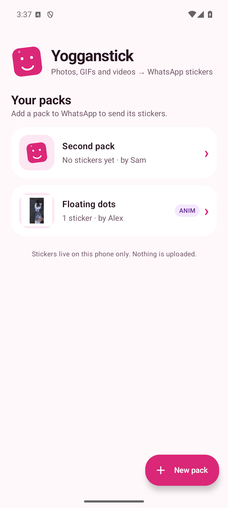
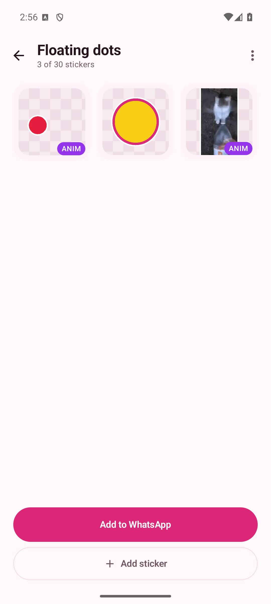
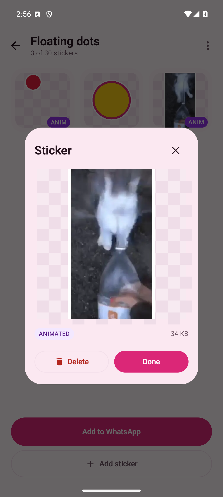
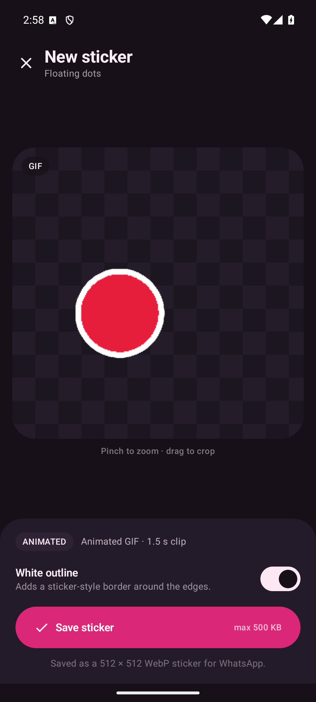
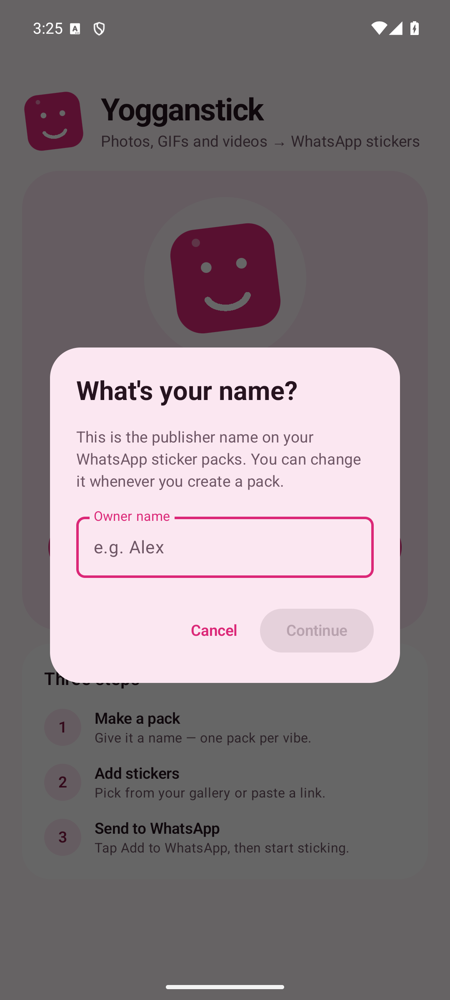
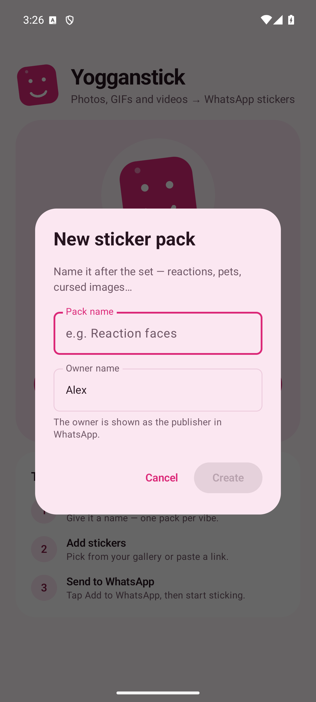

<p align="center">
  
</p>

<h1 align="center">Yogganstick</h1>

<p align="center">Turn photos, GIFs, videos — or a link from X — into WhatsApp stickers.</p>

<p align="center">
  <a href="https://github.com/SergioJuniorCE/yogganstick/actions/workflows/android-apk.yml">
    
  </a>
</p>

<p align="center">
  
  
  
  
</p>

<p align="center">
  
  
</p>

Yogganstick is a local-first Android sticker maker. Crop anything to a 512×512
sticker, add an optional white sticker outline, keep GIFs and videos animated,
and publish packs directly to WhatsApp.

## Features

- **Photos, GIFs and videos** from the system photo picker.
- **Paste an X/Twitter link** to fetch its GIF, video or photo without downloading it first.
  Direct `.gif`, `.mp4`, `.jpg`, `.png` and `.webp` links work too.
- **Live preview** — GIFs and videos loop in the editor while you crop, with the outline applied.
- **Owner name** — asked once, remembered as the default publisher for new packs, and editable
  each time you create one.
- **Pinch to zoom, drag to crop** using the same framing for the preview and the export.
- **White outline** for the classic sticker look, with transparency preserved.
- **Trim** videos and GIFs to the first 3 seconds with a start-time slider.
- **Real WhatsApp packs** via the Sticker Content Provider API, including tray icons and
  the official Add to WhatsApp intent.
- **Up to 30 stickers per pack**. Still stickers are ≤100 KB, animated stickers are ≤500 KB.
- **Local by default** — media is decoded and encoded on-device. Fetching a pasted link
  is the only network request.

## Build

Requirements: JDK 17+ (this project was built with JDK 21), Android SDK 36.
Point Gradle at the SDK with a `local.properties` file (`sdk.dir=...`) or open the
project in Android Studio.

```powershell
.\gradlew.bat assembleDebug
adb install -r app/build/outputs/apk/debug/app-debug.apk
```

On macOS/Linux use `./gradlew` instead.

The app supports Android 9 (API 28) and newer.

### Tests

```powershell
.\gradlew.bat testDebugUnitTest            # link parsing, WebP muxing, crop math
.\gradlew.bat connectedDebugAndroidTest    # GIF/video decode + WhatsApp provider contract
.\gradlew.bat lintDebug
```

## Nightly builds (CI/CD)

The GitHub Actions workflow at `.github/workflows/android-apk.yml` follows the same
nightly pattern used by Yogganga:

- runs daily at **03:00 UTC**, and on manual **workflow_dispatch**;
- skips the build when the default branch has not moved since the last `nightly`
  release, unless it was started manually;
- stamps `versionCode` with the workflow run number and `versionName` with
  `<base>-nightly.YYYYMMDD` (currently `1.0-nightly.YYYYMMDD`);
- builds a signed **release** APK, uploads it as an artifact, and recreates the
  `nightly` GitHub release with `yogganstick-nightly.apk`.

### Release signing secrets

Generate a release keystore once, back it up, and keep it out of git. Add it to the
repository as secrets **after the project is pushed to GitHub**:

```bash
keytool -genkeypair -v -storetype PKCS12 -keystore release.keystore \
  -alias yogganstick -keyalg RSA -keysize 2048 -validity 10000
base64 -w0 release.keystore > release.keystore.b64
gh secret set ANDROID_KEYSTORE_BASE64 < release.keystore.b64
gh secret set ANDROID_KEYSTORE_PASSWORD
gh secret set ANDROID_KEY_ALIAS --body yogganstick
gh secret set ANDROID_KEY_PASSWORD
```

On Windows:

```powershell
keytool -genkeypair -v -storetype PKCS12 -keystore release.keystore `
  -alias yogganstick -keyalg RSA -keysize 2048 -validity 10000
$b64 = [Convert]::ToBase64String([IO.File]::ReadAllBytes("release.keystore"))
gh secret set ANDROID_KEYSTORE_BASE64 --body $b64
gh secret set ANDROID_KEYSTORE_PASSWORD
gh secret set ANDROID_KEY_ALIAS --body yogganstick
gh secret set ANDROID_KEY_PASSWORD
```

The workflow requires all four secrets. Keep the keystore backed up: Android only
installs a nightly over a previous build signed with the same key. If the secrets are
missing, the signing step fails with a clear error.

Debug builds use a different signature, so uninstall a debug build before installing
a nightly APK for the first time.

You can also reuse the Yogganga release keystore/secrets so both projects share the
same signing identity. Trigger a build from **Actions → Android APK → Run workflow**;
the latest APK is attached to the `nightly` release of the repository.

## How it works

- **Decoding** — images use `ImageDecoder`; GIFs use Glide's pure-Java GIF decoder, which
  preserves transparency and frame disposal; videos use `MediaMetadataRetriever`.
  Some X/Twitter MP4s are valid but rejected by the platform extractor, so the app falls
  back to a Media3 Transformer normalization pass before reading frames.
- **Live preview** — animated sources are decoded into a short, small frame loop
  (up to 18 frames, at most 512 px) and replayed in the editor. The crop, zoom and outline
  apply live. Saving re-samples from the source at export quality.
- **Encoding** — Android's platform WebP encoder produces each 512×512 frame. A small RIFF
  muxer assembles them into an animated WebP (`VP8X`/`ANIM`/`ANMF`), including `ALPH`
  chunks so transparent animated stickers stay transparent.
- **WhatsApp** — `StickerContentProvider` exposes pack metadata, sticker lists, tray images
  and WebP assets. Packs are stored in `filesDir/packs`; metadata is versioned so WhatsApp
  picks up changes.
- **Link import** — X links are resolved through the FxTwitter API with a direct HTML
  fallback, downloaded to cache, then flow through the normal editor. No API key needed.

## Project layout

```
app/src/main/java/com/yogganstick/
  AppViewModel.kt          navigation, editor session, async work
  MainActivity.kt          Compose root
  data/                    pack model + JSON/local file store
  media/                   source decoding, GIF/video handling, WebP encoding/muxing
  net/                     X/Twitter link resolution + download
  provider/                WhatsApp sticker ContentProvider
  ui/                      Compose theme and screens
```

## Notes

- WhatsApp must be installed to add a pack; the in-app editor works without it.
- Pack files and preferences are excluded from Android backup and device transfer.
- Not affiliated with WhatsApp. Stickers you make are yours to use.

Created in [T3 Code](https://t3.codes).
